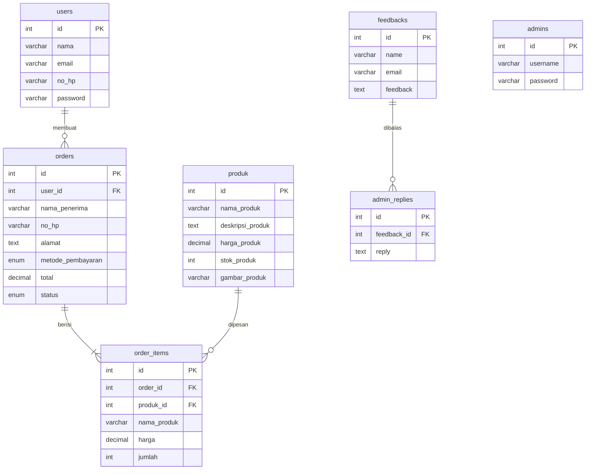

# Driptique – Website E-Commerce Thrift

Driptique adalah website toko online untuk penjualan pakaian thrift. Pelanggan bisa melihat dan mencari produk,
memasukkan barang ke keranjang, checkout, memantau status pesanan, dan mengirim feedback. Admin mengelola produk,
pesanan, pelanggan, feedback, dan akun admin dari panel khusus.

## Fitur

**Pelanggan**
- Registrasi dan login (password di-hash dengan `password_hash`)
- Daftar produk dengan pencarian dan pengurutan
- Halaman detail produk
- Keranjang belanja (tambah, ubah jumlah, hapus) dengan pengecekan stok
- Checkout dengan data pengiriman dan metode pembayaran (transfer / COD)
- Riwayat dan status pesanan
- Formulir feedback dan melihat balasan admin

**Admin** (`/admin`)
- Login admin terpisah, semua halaman admin wajib login
- Dashboard: jumlah produk, pesanan baru, pelanggan, feedback belum dibalas, pendapatan, stok menipis
- CRUD produk dengan upload gambar (validasi tipe dan ukuran, nama file acak)
- Kelola pesanan dan ubah status (pembatalan mengembalikan stok otomatis)
- Daftar pelanggan dan total belanja
- Balas, ubah, dan hapus feedback
- Kelola akun admin dan ganti password

**Keamanan**
- Prepared statement untuk semua query (mencegah SQL injection)
- Escape output dengan `htmlspecialchars` (mencegah XSS)
- Token CSRF di semua form POST; hapus data hanya lewat POST
- Session di-regenerate saat login
- Kredensial database disimpan di `config.php` yang tidak ikut di-commit
- Transaksi database dan `SELECT ... FOR UPDATE` saat checkout agar stok tidak minus

## Teknologi
- PHP 8 (native, mysqli), MySQL / MariaDB
- HTML, CSS, JavaScript
- AdminLTE 3 + Bootstrap 4 untuk panel admin, Font Awesome untuk ikon

## Struktur Folder
```
├── admin/              Panel admin (dashboard, produk, pesanan, pelanggan, feedback, akun admin)
├── assets/css/         Stylesheet halaman toko
├── aset-gambar/        Logo dan gambar tampilan
├── database/db_uas.sql Struktur tabel + data awal
├── dist/, plugins/     File AdminLTE, Bootstrap, jQuery, Font Awesome (pihak ketiga)
├── images/             Gambar produk (images/uploads untuk hasil upload admin)
├── includes/           Fungsi bersama, header dan footer toko
├── config.example.php  Contoh konfigurasi database
├── db.php              Koneksi database tunggal
└── *.php               Halaman toko (index, produk, keranjang, checkout, dll.)
```

## Cara Menjalankan

**Kebutuhan:** PHP 8.0+ dengan ekstensi `mysqli` dan `fileinfo`, MySQL 5.7+/8 atau MariaDB 10.3+.

1. Clone repo
   ```bash
   git clone https://github.com/RicoSatyadharmaPutraSuryawan/UASPEMWEB-Ecommerce-Website.git
   cd UASPEMWEB-Ecommerce-Website
   ```
2. Buat database dan impor data
   ```bash
   mysql -u root -p -e "CREATE DATABASE db_uas CHARACTER SET utf8mb4 COLLATE utf8mb4_unicode_ci;"
   mysql -u root -p db_uas < database/db_uas.sql
   ```
   Bisa juga lewat phpMyAdmin: buat database `db_uas`, lalu Import `database/db_uas.sql`.
3. Salin `config.example.php` menjadi `config.php`, lalu isi password MySQL
   ```bash
   cp config.example.php config.php
   ```
4. Jalankan server
   ```bash
   php -S localhost:8000
   ```
   Atau taruh folder di `htdocs` XAMPP dan buka `http://localhost/NAMA_FOLDER`.
5. Buka `http://localhost:8000`

## Akun Uji

| Peran    | Login                         | Password      | Halaman                 |
|----------|-------------------------------|---------------|-------------------------|
| Admin    | `admin`                       | `admin123`    | `/admin/login.php`      |
| Customer | `customer@driptique.test`     | `customer123` | `/login.php`            |

Ganti password admin setelah instalasi di menu **Akun Admin**.

## Struktur Database



`order_items` menyimpan salinan nama dan harga produk, jadi riwayat pesanan tetap benar walaupun produk diubah atau dihapus.

## Alur Kerja Tim
- Sebelum mulai: `git pull`
- Selesai: `git add .`, `git commit -m "pesan"`, `git push`
- Jangan commit `config.php` (sudah ada di `.gitignore`)
- Daftar tugas tersisa ada di [`docs/CHECKLIST.md`](docs/CHECKLIST.md)

## Tim
- Rico Satyadharma Putra Suryawan
- _(nama teman)_

Dikembangkan dari proyek UAS Pemrograman Web karya Antonyy004 (repo asal: Antonyy004/UASPEMWEB-Ecommerce-Website).
